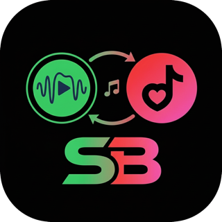
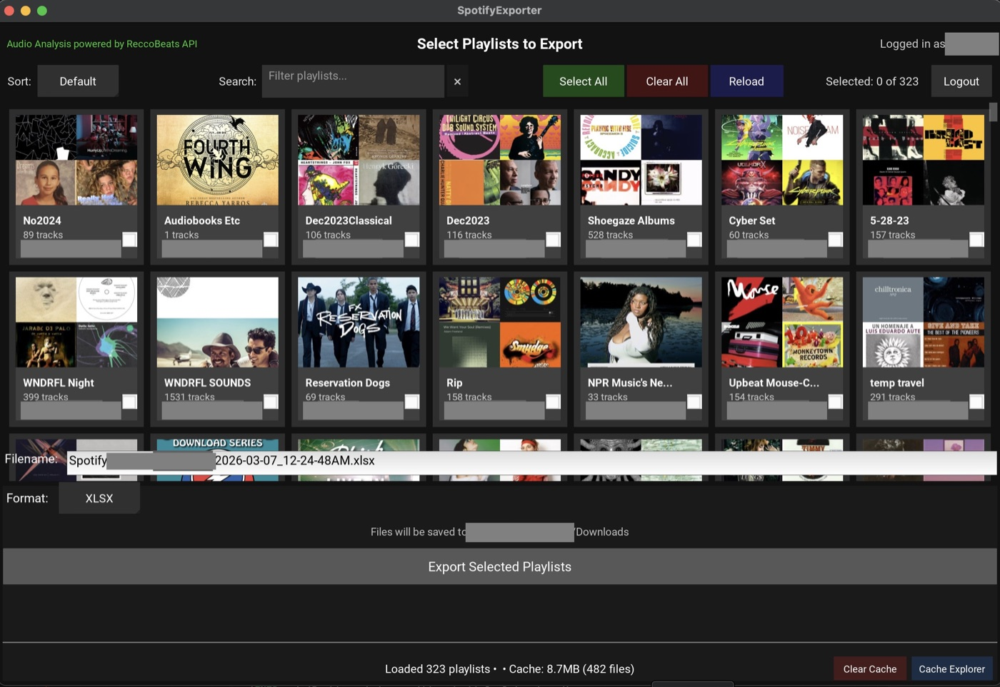
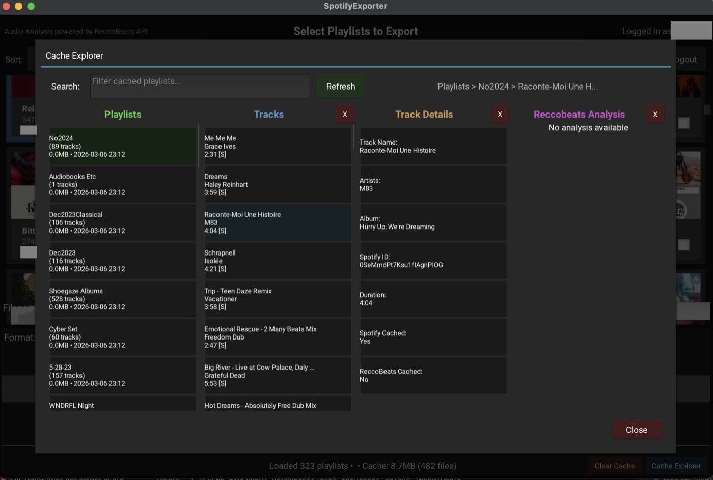
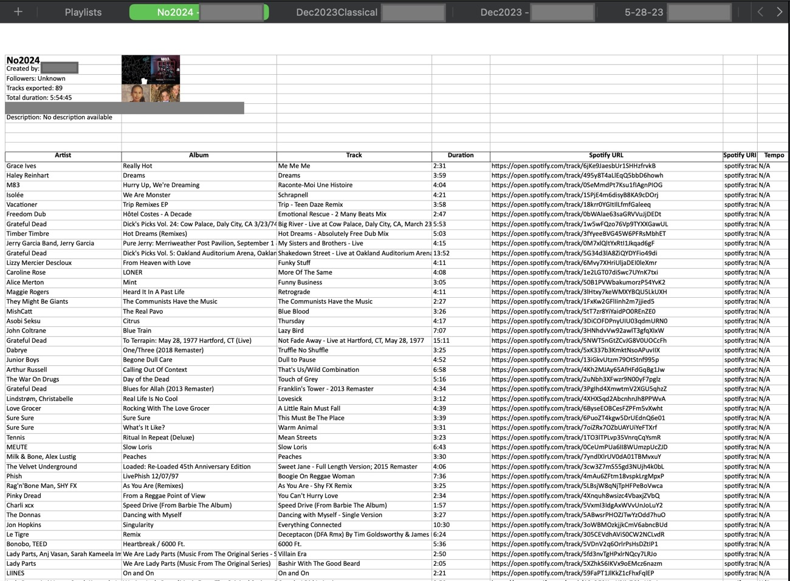

  <!-- Regenerate: sips -Z 320 "resources/SpotiBye black edited 1-modified.png" --out resources/spotibye-logo-320.png -->
  

<h1 align="center">SpotiBye</h1>

  Export your Spotify playlists to <strong>CSV</strong>, <strong>XLSX</strong>, or <strong>JSON</strong>, with optional audio-feature analysis.

  
  
  
  <!-- Security Scan and OSV PR Scan badges are omitted on purpose: both workflows are PR-only with path filters, so their badges would show a misleading status for main. -->

SpotiBye is a desktop app: log in with Spotify, browse your playlists, analyze them, and export the results to a file. All Spotify API traffic goes through the backend — whether run locally or deployed to Cloudflare — so your Spotify password never touches the app, and client credentials live only on the backend.

## Features

- **Playlist export** — save any playlist as CSV, XLSX, or JSON
- **Playlist analysis** — per-track audio features (tempo, key, danceability, energy, valence, acousticness, instrumentalness, liveness, speechiness, loudness) with live progress
- **Cloud backend** — fast, cached processing on Cloudflare Workers; resumable exports for multi-playlist exports
- **Private by design** — Spotify OAuth 2.0 PKCE; Spotify access and refresh tokens are managed server-side and never stored on your device (the app keeps only a backend-issued session token)

## Screenshots

  

  
  

Screenshots are from an earlier build, and personal details are blanked out.

## Requirements

- Windows 10+, macOS 10.15 (Catalina)+, or a modern Linux distribution
- A Spotify account (Free or Premium) and a browser for login

## Install & Use

Full instructions live in [`docs/`](docs/index.md):

- [Installation](docs/installation-instructions.md) — download, install, and first launch
- [Configuration](docs/configuration-options.md) — settings and environment options
- [User guide](docs/user-guide-cloud-backend.md) — playlists, analysis, and exports
- [Troubleshooting](docs/troubleshooting-network.md) and [connectivity FAQ](docs/faq-connectivity.md)

## Self-Hosting

Spotify only allows a small number of users on an unapproved developer app, so there are no public downloads yet — each person currently runs their own backend. [Self-host in about 15 minutes](docs/self-hosting.md): local backend first, Cloudflare deploy as a secondary path. A managed hosted version may be offered commercially later.

## How It Works

- **Frontend** (`src/frontend/`) — Python desktop GUI built with Kivy/KivyMD
- **Backend** (`src/backend/`) — Cloudflare Worker (TypeScript + Hono) handling auth, Spotify API calls, analysis queueing, and caching

See [`ARCHITECTURE.md`](ARCHITECTURE.md) for layer contracts and data flow, and [`CHANGELOG.md`](CHANGELOG.md) for release history.

## Development

- Developer docs start at [`dev-docs/README.md`](dev-docs/README.md); builds and deploys are covered in [`dev-docs/guides/build-and-deploy-guide.md`](dev-docs/guides/build-and-deploy-guide.md)
- Backend: `cd src/backend && npm run test:run && npm run lint`
- Frontend (with your Python environment active): `KIVY_WINDOW=headless KIVY_NO_ENV_CONFIG=1 python -m pytest src/frontend/tests/ -v`
- Quick check of everything: `./scripts/verify-all.sh` from the repo root

## Security

See [`SECURITY.md`](SECURITY.md) for the security policy and the scanning tools enforced in CI. To report a vulnerability, please use a [private security advisory](https://github.com/kgrizz-git/SpotiBye/security/advisories/new) instead of opening a public issue.

## Contributing

Bug reports and feature requests are welcome via [GitHub Issues](https://github.com/kgrizz-git/SpotiBye/issues). Pull requests should change one logical thing, state what changed and why, and keep CI green.

## License

SpotiBye is free software: you can redistribute it and/or modify it under the terms of the [GNU General Public License v3.0 or later](LICENSE).
